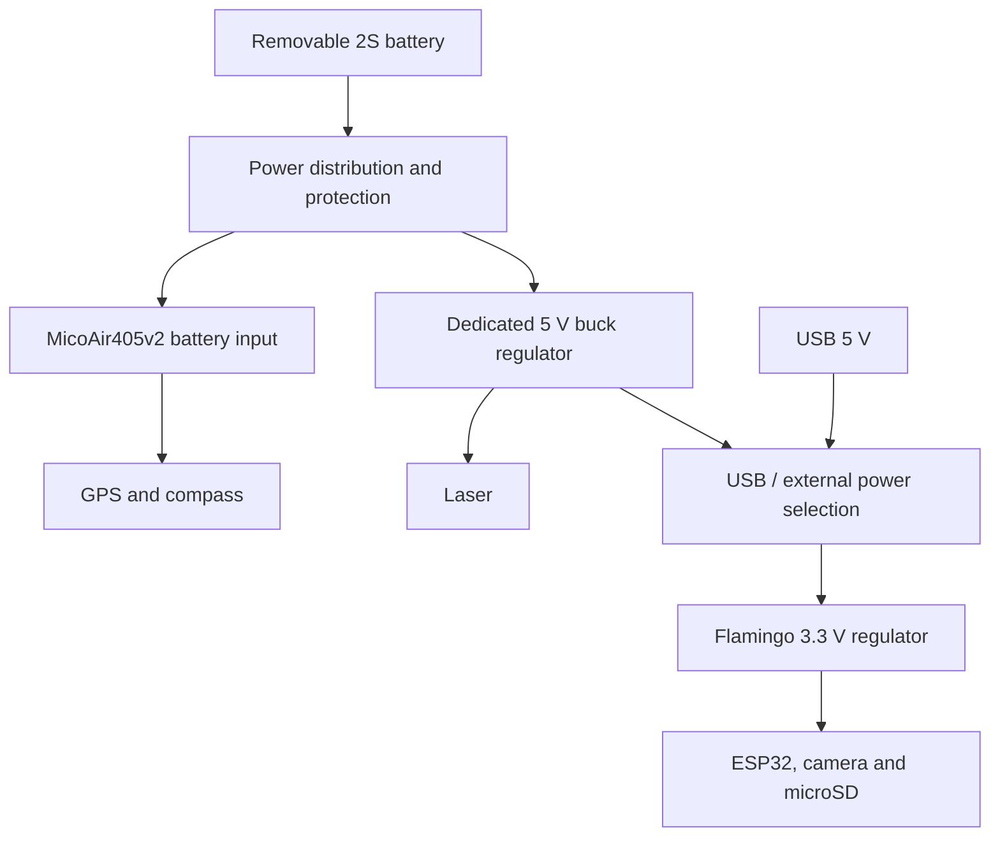

# Flamingo components and design plan

Updated: 2026-11-10.

Flamingo detects a colored 16 x 16 m tarp from approximately 1 km. It handles the camera, laser and payload logging; a separate flight controller supplies navigation and flight control. This document records the selected architecture and proposed parts. Schematic work and hardware validation are still pending.

## Current decisions

- **Processor:** ESP32-S3-WROOM-1-N16R8, with 8 MB PSRAM and 16 MB flash.
- **Camera:** external Waveshare OV5640 Camera Board (A), 5 MP DVP/JPEG.
- **Flight controller:** MicoAir405v2, with an external M10G-5883 GPS/compass.
- **Laser:** module described as STA-M020X in the supplied SAT-M020X PDF; 5 V supply and default 3.3 V UART.
- **Power:** one removable battery shared by both boards, with a dedicated regulator branch for Flamingo. Charge the pack externally; no built-in charging.
- **Images:** capture JPEG and decode sequential blocks into a reusable buffer.
- **Size:** plan around 50 x 80 mm for Flamingo; maximum 50 x 100 mm. This is an allowance, not a completed placement.

## Power

Use a **2S LiPo** as the planning baseline: 7.4 V nominal, 8.4 V fully charged. The MicoAir405v2 accepts 2S-6S. Battery capacity and discharge rating remain open until runtime and any motor/servo loads are known.

All boards share ground. The FC and Flamingo use separate regulator branches; Flamingo does not depend on the FC's 5 V accessory output. A shared battery is still a common point of failure.

| Power item | Plan |
|---|---|
| Battery and charging | Removable 2S pack and external balance charger. No charger on Flamingo. |
| Flight controller | Battery branch to the FC's designated VBAT/GND input; GPS powered from the FC's suitable 5 V output. |
| Flamingo input | Dedicated battery-to-5 V buck regulator, upstream of its 5 V input. Exact regulator and whether it is onboard or a separate module are still to select. |
| Main 3.3 V rail | ESP32, complete camera board and microSD. Start with approximately 1 A output capability, then verify actual peaks and thermals. |
| Laser rail | Dedicated buck's 5 V output. Datasheet specifies 3-5 V input, recommends 5 V and lists peak power <=0.55 W, equivalent to 110 mA at 5 V. Size with margin and verify startup pulses and voltage tolerance. |
| USB power | Select USB or external 5 V with reverse-current blocking. Do not tie their positive outputs directly together. USB-only operation should power Flamingo for programming; it need not power the FC or laser. |
| Protection | Select connector, switch, branch protection, reverse-polarity protection and battery low-voltage handling with the actual pack and loads. |

**Remove from the planned BOM:** BQ24074 charger, its charging-current/termination/timer/NTC network, and charging-status circuitry. The old single-cell battery-to-charger-OUT power path is superseded. Existing copied CAD has not been edited.

The TPS63070 remains a **candidate** for 5 V to 3.3 V, not a required part. A buck-only regulator may be simpler. Do not populate a regulator until its support circuit and load budget are reviewed. Pelican's TPS61023 boost is not required to generate the laser's 5 V in this architecture.

Sources: [FC power specifications](https://ardupilot.org/copter/docs/common-MicoAir405v2.html), [TPS63070 specifications](https://www.ti.com/product/TPS63070), and the supplied laser manual, pp. 2-3.

## Components

JLC links identify catalog entries. Recheck stock, price and assembly eligibility before ordering; earlier stock checks are not current guarantees.

| Function | Part / source | Status and notes |
|---|---|---|
| ESP32 module | ESP32-S3-WROOM-1-N16R8 - [C2913202](https://jlcpcb.com/partdetail/C2913202) | Selected. 8 MB Octal PSRAM, 16 MB flash, Wi-Fi/BLE, antenna and 40 MHz crystal included. 3.3 V supply; body 18 x 25.5 x 3.1 mm. KiCad family: `RF_Module:ESP32-S3-WROOM-1`; use the complete ordering code as its value. |
| Flight controller | [MicoAir405v2 Only FC / ArduPilot](https://store.micoair.com/product/micoair405v2/) | Recommended external board: BMI088 IMU, SPL06 barometer and microSD. No onboard GPS. Vehicle firmware/configuration still needs validation. |
| GPS/compass | [MicoAir M10G-5883](https://store.micoair.com/product/m9-m10-gps-module/) | External module on FC UART3/I2C. Flamingo does not need its own GNSS, IMU, compass or barometer under this plan. |
| Camera | [Waveshare OV5640 Camera Board (A), SKU 13926](https://www.waveshare.com/product/modules/cameras-audio-video/cameras/ov5640-camera-board-a.htm) | Proposed complete camera board, purchased separately. 3.3 V input, onboard sensor regulators, 8-bit DVP and JPEG. |
| Laser | STA-M020X per supplied manual | External module; confirm actual label matches the manual. About 14 g, diameter 23 x 47 mm. |
| microSD socket | XUNPU TF-115-BCP9 - [C720505](https://jlcpcb.com/partdetail/Xunpu-TF_115BCP9/C720505) | Proposed Pelican reuse; 3.3 V SPI. Check symbol/pad mapping and shell grounds. |
| USB-C | GCT USB4120-03-C - [C3445864](https://jlcpcb.com/partdetail/GCT-USB4120_03C/C3445864) | Proposed native programming/console/JTAG. Vertical connector; check cable access and footprint. |
| USB ESD | ST USBLC6-2SC6 - [C7519](https://jlcpcb.com/partdetail/C7519) | Proposed; check ST pinout and VBUS/ground treatment. |
| Dedicated 5 V regulator | To select | 2S battery to 5 V for Flamingo and laser; include startup/current margin. |
| Main 3.3 V regulator | Candidate TPS63070RNMR - [C109322](https://jlcpcb.com/partdetail/TexasInstruments-TPS63070RNMR/C109322) | Fed from selected 5 V, not a charger output. Exact topology/support parts pending. |
| USB/external power selector | To select | Two 5 V sources; reverse-current blocking required. Copied TPS2116 library is only a candidate. |
| Connectors | Camera, laser, FC telemetry, 5 V input and expansion | Exact mating parts, footprints, contact order and cable orientation still to select. |

## Laser interface

Source: [supplied SAT-M020X LRF Module.pdf](<C:/Users/sikap/Downloads/SAT-M020X LRF Module.pdf>), pp. 2-3 and 7-9. The document itself calls the model **STA-M020X**.

| Property | Datasheet value / design implication |
|---|---|
| Power | 3-5 V input; 5 V recommended. Operating current <=90 mA, standby <=20 mA, peak power <=0.55 W. Current and power figures are not fully consistent; verify real startup/measurement demand. |
| Serial logic | TTL UART; factory I/O voltage 3.3 V, configurable. Direct S3 UART is the candidate interface at the confirmed 3.3 V setting. Supply voltage and UART logic voltage are separate. |
| Defaults | 19200 baud, slave address `0x10`, automatic result output after ranging. Confirm serial framing and actual settings on the received unit. |
| Range / rate | 5 m minimum; advertised 2000 m for buildings and 1500 m for trees; 1-3 Hz. Tarp range in daylight still needs testing. |
| Accuracy | Manual claims +/-1 m; 0.1 m data steps are resolution, not 0.1 m accuracy. |

The **module connector has five pins**, not six. The earlier six-way carrier connector request can be retained with an unused sixth contact and a suitable harness, but the exact connectors are not selected.

| Module contact | Signal | Proposed Flamingo connection |
|---|---|---|
| 1 | GND | Common ground |
| 2 | Vin | Regulated 5 V laser supply |
| 3 | TXD, output from laser | GPIO39 / ESP32 UART RX |
| 4 | RXD, input to laser | GPIO38 / ESP32 UART TX |
| 5 | ENO, enable/reserved | Leave unconnected pending manufacturer clarification |

Confirm connector pitch, pin-1 orientation and harness continuity before drawing a numbered carrier connector. Do not infer ENO voltage, polarity or pull requirements from its name.

Protocol starting point: frames are `SlaveID + command + parameters + checksum`. The checksum is the negative sum of command/parameter bytes modulo 256; exclude SlaveID. Verified manual examples: communication test `10 C0 40`; continuous ranging in meters `10 83 40 3D`. Check result validity, unit and resolution bits before interpreting distance. Some manual examples/labels contain inconsistencies; test parsing against the actual module.

## Camera and image processing

Use **OV5640 Board A -> 8-bit DVP -> ESP32-S3**, configured for JPEG. The Espressif driver supports this sensor/chip combination. This is documentation-level compatibility; no capture or detection performance has been measured.

Start with one JPEG frame buffer in PSRAM and sequential decoding into a reusable strip/block buffer. Detect tarp color, retain positions/results, merge detections across block boundaries and reuse the buffer. Espressif's [esp_new_jpeg](https://components.espressif.com/components/espressif/esp_new_jpeg/versions/1.0.2/readme) supports block decoding.

| Decoded RGB565 buffer, 2592 x 1944 source | Memory |
|---|---:|
| Full image | 10,077,696 bytes; exceeds 8 MB PSRAM |
| Quarter of the pixels | 2,519,424 bytes, about 2.52 MB |
| Full-width strip, 64 rows | 331,776 bytes, about 0.33 MB |

Quarter-image processing is a memory-budget example; use sequential blocks with the decoder's required alignment. Budget the compressed JPEG, decoder workspace and detection state as well. Flash does not add working RAM. Validate peak memory, decoding time and color accuracy on hardware.

### Camera connector

The reference camera uses an **18-contact, 2 x 9 P1 header**, not Pelican's 20-pin FFC. Confirm pitch, mating, orientation and actual camera revision. These are P1 contacts, not the bare sensor's flex pins.

| P1 | Signal | ESP32 GPIO / role |
|---|---|---|
| 1 | 3.3 V | Regulated camera supply |
| 2 | GND | Common ground |
| 3 | SIO_CLK | GPIO5 / SCCB clock |
| 4 | SIO_DAT | GPIO4 / SCCB data |
| 5 | VSYNC | GPIO17 |
| 6 | HREF | GPIO18 |
| 7 | PCLK | GPIO16 |
| 8 | XCLK | GPIO21 / clock output |
| 9-16 | Y9, Y8, Y7, Y6, Y5, Y4, Y3, Y2 | GPIO15, 14, 13, 12, 11, 10, 9, 8 / driver D7-D0 |
| 17 | RESET | GPIO6 / active low |
| 18 | PWDN / OVPWDN | Leave open; driver `pin_pwdn = -1` |

**PWDN caveat:** the published schematic grounds sensor PWDN through R7 (0 ohm), while P1 contact 18 goes through R6 to OVPWDN. It does not establish that contact 18 controls sensor power-down. Verify the actual assembly before using it.

Board A already includes 1.5 V / 2.8 V sensor regulators, 4.7 kohm SCCB pull-ups to 3.3 V and a reset network. Avoid duplicating pull-ups without checking the combined value. Start with a short cable, approximately 5 cm or less, and review clock/data ground returns. Configure Octal PSRAM, 16 MB flash and `PIXFORMAT_JPEG`; validate small captures before increasing to 5 MP. A 20 MHz XCLK is a starting configuration, not a throughput guarantee.

Camera references: [manual](https://files.waveshare.com/upload/b/b8/OV5640_Camera_Board_%28A%29_User_Manual_EN.pdf), [schematic](https://files.waveshare.com/upload/1/1e/OV5640-Camera-Board-Schematic.pdf), [Espressif driver](https://github.com/espressif/esp32-camera).

## Proposed GPIO allocation

These are candidate assignments for the exact N16R8 module, not implemented schematic or firmware connections.

| Interface | GPIOs / notes |
|---|---|
| Camera | 4/5 SCCB, 6 RESET, 8-15 D0-D7, 16 PCLK, 17 VSYNC, 18 HREF, 21 XCLK |
| USB Serial/JTAG | 19 D-, 20 D+ |
| FC telemetry | 1 TX -> FC R4; 2 RX <- FC T4; common ground |
| Laser UART | 38 TX -> laser RXD; 39 RX <- laser TXD |
| Shared SPI | 40 SCLK, 41 MOSI, 42 MISO |
| microSD CS | 47; pull up for startup |
| Expansion SPI CS | 48; separate pull-up |
| Optional UART0 debug | 43 TX, 44 RX |
| Spare | 7; additional control signals may consume it |
| Boot/strapping | 0, 3, 45, 46; review startup loads, reserve GPIO0 for BOOT |
| PSRAM occupied | 35, 36, 37 unavailable |

GPIO47/48 are 3.3 V in this N16R8 plan. Use USB JTAG; GPIO39-42 are already assigned elsewhere. An I2C header can share GPIO4/5 if addresses, pull-ups and SCCB/I2C ownership are coordinated. Initialize SD into SPI mode before other devices use the shared bus; each device needs its own CS and must release MISO. [SD/SPI sharing guide](https://docs.espressif.com/projects/esp-idf/en/stable/esp32s3/api-reference/peripherals/sdspi_share.html)

## Flight-controller link

Use FC UART4 / ArduPilot `SERIAL4` and non-inverted 3.3 V UART. Candidate settings: MAVLink 2 (`SERIAL4_PROTOCOL = 2`), 115200 baud, 8N1. Telemetry connector carries TX, RX and GND; Flamingo power arrives through its separate regulator branch.

Keep GPS on FC UART3, with compass on FC I2C. Request position, attitude, GNSS quality, health and timestamps using `GLOBAL_POSITION_INT`, `ATTITUDE` or `ATTITUDE_QUATERNION`, `GPS_RAW_INT`, `HEARTBEAT`, `SYS_STATUS` and appropriate time-sync messages. Use `MAV_CMD_SET_MESSAGE_INTERVAL` and measure actual delivered rates. Reject stale or invalid navigation data.

GPS/barometric altitude is not automatically height above terrain; laser distance is along its beam. Locating the tarp also needs camera calibration, mounting alignment, attitude, geometry and synchronized measurements. Validate the vehicle-specific ArduPilot build and features; board support alone does not establish suitability for rocket ascent or deployment.

References: [FC manual](https://micoair.com/en/docs/flight-controller/micoair405v2/micoair405v2-flight-controller-manual), [GPS manual](https://micoair.com/en/docs/gps-rtk/gps), [ArduPilot serial configuration](https://ardupilot.org/copter/docs/common-serial-options.html), [message requests](https://ardupilot.org/dev/docs/mavlink-requesting-data.html).

## Schematic work remaining

- Select the battery capacity, runtime target and any motor/servo power branches.
- Select the 5 V buck, 3.3 V regulator, USB power selector, protection and all support components.
- Add power inputs, decoupling, EN reset network, BOOT/RESET buttons and antenna clearance. Candidate S3 starting values: 10 uF + 100 nF supply decoupling; EN 10 kohm / 1 uF RC, subject to reference-design review.
- Add USB with one 5.1 kohm pull-down on each CC pin; check ESD wiring, connector mapping and any D+/D- series resistors.
- Confirm camera and laser hardware revisions, cable mappings and connector footprints. Verify laser I/O voltage and ENO treatment.
- Check every symbol pin against its footprint and datasheet, then review the complete pin allocation and startup states.
- Measure power peaks, brownout behavior, USB/external source switching, 5 MP capture/decode memory and detection performance.
- Test timestamped FC telemetry, laser validity handling and link loss during camera capture and SD writes.

Keep 50 x 80 mm as the preliminary PCB allowance, within the 50 x 100 mm maximum. External buck placement is still open; a mounted battery, camera, laser, FC and GPS need separate mechanical space. The FC body is about 36 x 36 x 8 mm with 30.5 mm mounting spacing. Removing charging circuitry may save space, but routing has not been measured.

## Pelican reuse

Reuse only circuits and libraries that match the final design. Copied libraries are not evidence that a circuit has been placed or validated.

| Reuse candidate | Treatment |
|---|---|
| TF-115-BCP9 socket, suitable passives, LEDs and power symbols | Available as starting CAD; verify exact parts and pins. |
| TPS2116 source selector | Candidate for USB/external 5 V selection; review its complete circuit before reuse. |
| BQ24074 charger and charge-specific support | Excluded from the new design. Copied library files may remain unused. |
| TPS61023 boost, 1 uH inductor, battery-gating circuit and battery/switch connector | Historical circuits; not automatically part of the new power plan. |
| 20-pin camera FFC | Not the selected Board A connector. |

Key design references: [S3 module datasheet](https://documentation.espressif.com/esp32-s3-wroom-1_wroom-1u_datasheet_en.pdf), [S3 hardware guidelines](https://docs.espressif.com/projects/esp-hardware-design-guidelines/en/latest/esp32s3/index.html), [USB Serial/JTAG](https://docs.espressif.com/projects/esp-idf/en/stable/esp32s3/api-guides/usb-serial-jtag-console.html), [antenna layout](https://docs.espressif.com/projects/esp-hardware-design-guidelines/en/latest/esp32s3/pcb-layout-design.html).
