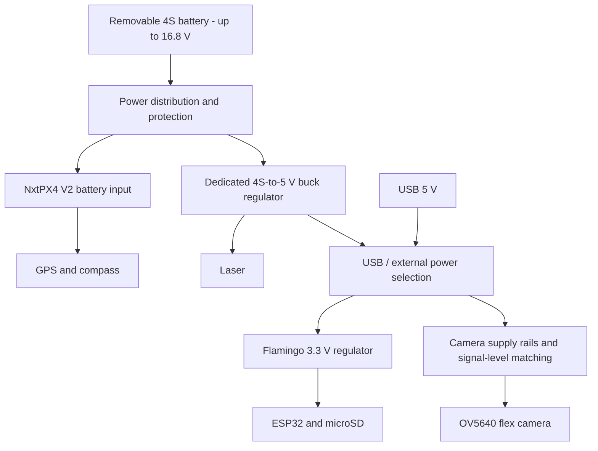

# Flamingo components and design plan

Updated: 2026-11-10.

Flamingo detects a colored 16 x 16 m tarp from approximately 1 km. It handles the camera, laser and payload logging; a separate flight controller supplies navigation and flight control. This document records the selected architecture and proposed parts. Schematic work and hardware validation are still pending.

## Current decisions

- **Processor:** ESP32-S3-WROOM-1-N16R8, with 8 MB PSRAM and 16 MB flash.
- **Camera:** [Seeed Studio OV5640 Camera for XIAO ESP32S3 Sense, with heat sink](https://www.seeedstudio.com/OV5640-Camera-for-XIAO-ESP32S3-Sense-With-Heat-Sink-p-5739.html), **SKU 114993115**: standalone 5 MP autofocus camera with a 24-contact flex tail. Flamingo supplies its camera-specific rails and I/O interface.
- **Flight controller:** [RoboFusion NxtPX4 V2 Mini Flight Controller - Only FC](https://robofusion.net/products/mini-px4flight-controller-nxtpx4-flight-controller-h743-bmi088-support-ardupilot-px4), with an external M10G-5883 GPS/compass.
- **Laser:** module described as STA-M020X in the supplied SAT-M020X PDF; 5 V supply and default 3.3 V UART.
- **Power:** one removable **4S LiPo** shared by both boards, with a dedicated 4S-to-5 V regulator branch for Flamingo. Charge the pack externally; no built-in charging.
- **Images:** capture JPEG and decode sequential blocks into a reusable buffer.
- **Size:** plan around 50 x 80 mm for Flamingo; maximum 50 x 100 mm. This is an allowance, not a completed placement.

## Power

Use a standard **4S LiPo: 14.8 V nominal, 16.8 V fully charged**. The selected RoboFusion NxtPX4 V2 listing specifies 3S-6S input, so 4S is supported. Battery capacity, discharge rating and runtime remain to select, including any motor/servo loads.

All boards share ground. The FC and Flamingo use separate regulator branches; Flamingo does not depend on the FC's 5 V accessory output. A shared battery is still a common point of failure.

| Power item | Plan |
|---|---|
| Battery and charging | Removable standard 4S pack and a compatible external 4S balance charger. No charger on Flamingo. |
| Flight controller | 4S battery branch to NxtPX4v2 VBAT/GND. Its 5 V / 2.5 A output supplies GPS and suitable FC peripherals; Flamingo uses a separate regulator branch. |
| Flamingo input | Dedicated 4S-to-5 V buck. Operating input rating must exceed 16.8 V with transient margin; target a 24 V-or-higher maximum operating input rating with suitable protection. Exact regulator, current rating and onboard/external placement remain to select. |
| Main 3.3 V rail | ESP32, microSD and appropriate interface circuitry. Approximately 1 A is an initial capability target; recalculate the full camera/regulator load and peaks. The flex camera is not a single-3.3 V-input carrier board. |
| Camera rails and logic | Add camera-specific low-voltage supplies, decoupling and signal-level matching. Confirm the received module revision before selecting rail values or connecting it to 3.3 V GPIO. |
| Laser rail | Dedicated buck's 5 V output. Datasheet specifies 3-5 V input, recommends 5 V and lists peak power <=0.55 W, equivalent to 110 mA at 5 V. Size with margin and verify startup pulses and voltage tolerance. |
| USB power | Select USB or external 5 V with reverse-current blocking. Do not tie their positive outputs directly together. USB-only operation should power Flamingo for programming; it need not power the FC or laser. |
| Protection | Select connector, switch, branch protection, reverse-polarity protection and battery low-voltage handling with the actual pack and loads. |

**Remove from the planned BOM:** BQ24074 charger, its charging-current/termination/timer/NTC network, and charging-status circuitry. The old single-cell battery-to-charger-OUT power path is superseded. Existing copied CAD has not been edited.

The TPS63070 remains a **candidate only for the downstream 5 V to 3.3 V stage**. Its maximum operating input is 16 V, below a full 4S pack: **do not connect it directly to 4S or use it as the 4S-to-5 V buck**. A buck-only regulator may be simpler for 5 V to 3.3 V. Review support circuits and the load budget before selecting either regulator. Pelican's TPS61023 boost is not required for the laser rail.

Sources: [selected RoboFusion controller](https://robofusion.net/products/mini-px4flight-controller-nxtpx4-flight-controller-h743-bmi088-support-ardupilot-px4), [NxtPX4v2 manual](https://micoair.com/en/docs/flight-controller/nxtpx4/nxtpx4v2-flight-controller-manual), [TPS63070 specifications](https://www.ti.com/product/TPS63070), and the supplied laser manual, pp. 2-3.

## Components

JLC links identify catalog entries. Recheck stock, price and assembly eligibility before ordering; earlier stock checks are not current guarantees.

| Function | Part / source | Status and notes |
|---|---|---|
| ESP32 module | ESP32-S3-WROOM-1-N16R8 - [C2913202](https://jlcpcb.com/partdetail/C2913202) | Selected. 8 MB Octal PSRAM, 16 MB flash, Wi-Fi/BLE, antenna and 40 MHz crystal included. 3.3 V supply; body 18 x 25.5 x 3.1 mm. KiCad family: `RF_Module:ESP32-S3-WROOM-1`; use the complete ordering code as its value. |
| Flight controller | [RoboFusion NxtPX4 V2 Mini - Only FC](https://robofusion.net/products/mini-px4flight-controller-nxtpx4-flight-controller-h743-bmi088-support-ardupilot-px4) | Selected external board: STM32H743 at 480 MHz, 2 MB program flash, dual BMI088 IMUs, SPL06 barometer, microSD, 7 UARTs and 8 PWM outputs. ArduPilot/PX4 support; 3S-6S input. No onboard GPS or compass. Vehicle configuration still needs validation. |
| GPS/compass | [MicoAir M10G-5883](https://store.micoair.com/product/m9-m10-gps-module/) | External module on FC UART1 / GPS1 (ArduPilot SERIAL3), with compass on external I2C. Flamingo does not need its own GNSS, IMU, compass or barometer. |
| Camera | [Seeed Studio OV5640 AF camera with heat sink, SKU 114993115](https://www.seeedstudio.com/OV5640-Camera-for-XIAO-ESP32S3-Sense-With-Heat-Sink-p-5739.html) | Selected standalone flex camera, purchased separately; no XIAO development board is required in Flamingo. 5 MP, autofocus, DVP; design for a 24-contact 0.5 mm-pitch FPC connection. Replaces Waveshare Board A and its 18-pin header. |
| Camera connector / supplies | Exact socket, regulators and level-matching parts to select | Match the actual flex revision, contact side, cable thickness, voltage domains and high-speed DVP timing. No camera rail/translator part is selected yet. |
| Laser | STA-M020X per supplied manual | External module; confirm actual label matches the manual. About 14 g, diameter 23 x 47 mm. |
| microSD socket | XUNPU TF-115-BCP9 - [C720505](https://jlcpcb.com/partdetail/Xunpu-TF_115BCP9/C720505) | Proposed Pelican reuse; 3.3 V SPI. Check symbol/pad mapping and shell grounds. |
| USB-C | GCT USB4120-03-C - [C3445864](https://jlcpcb.com/partdetail/GCT-USB4120_03C/C3445864) | Proposed native programming/console/JTAG. Vertical connector; check cable access and footprint. |
| USB ESD | ST USBLC6-2SC6 - [C7519](https://jlcpcb.com/partdetail/C7519) | Proposed; check ST pinout and VBUS/ground treatment. |
| Dedicated 5 V regulator | To select | 4S battery (up to 16.8 V) to 5 V for Flamingo and laser. Check operating input/transient margin and combined peak-current capability. |
| Main 3.3 V regulator | Candidate TPS63070RNMR - [C109322](https://jlcpcb.com/partdetail/TexasInstruments-TPS63070RNMR/C109322) | Fed only from selected 5 V; not directly from 4S (16 V maximum operating input). Exact topology/support parts pending. |
| USB/external power selector | To select | Two 5 V sources; reverse-current blocking required. Copied TPS2116 library is only a candidate. |
| Connectors | Camera, laser, FC telemetry, 5 V input and expansion | Exact mating parts, footprints, contact order and cable orientation still to select. |

## Laser interface

Source: [supplied SAT-M020X LRF Module.pdf](<C:/Users/sikap/Downloads/SAT-M020X LRF Module.pdf>), pp. 2-3 and 7-9. The document itself calls the model **STA-M020X**.

| Property | Datasheet value / design implication |
|---|---|
| Power | 3-5 V input; 5 V recommended. Operating current <=90 mA, standby <=20 mA, peak power <=0.55 W. Current and power figures are not fully consistent; verify real startup/measurement demand. |
| Serial logic | TTL UART; factory I/O voltage 3.3 V, configurable. Direct S3 UART is the candidate interface at the confirmed 3.3 V setting. Supply voltage and UART logic voltage are separate. |
| Defaults | 19200 baud, slave address `0x10`, automatic result output after ranging. Confirm serial framing and actual settings on the received unit. |
| Range / rate | 5 m minimum; advertised 2000 m for buildings and 1500 m for trees; 1-3 Hz. Tarp range in daylight still needs testing. |
| Accuracy | Manual claims +/-1 m; 0.1 m data steps are resolution, not 0.1 m accuracy. |

The **module connector has five pins**, not six. The earlier six-way carrier connector request can be retained with an unused sixth contact and a suitable harness, but the exact connectors are not selected.

| Module contact | Signal | Proposed Flamingo connection |
|---|---|---|
| 1 | GND | Common ground |
| 2 | Vin | Regulated 5 V laser supply |
| 3 | TXD, output from laser | GPIO39 / ESP32 UART RX |
| 4 | RXD, input to laser | GPIO38 / ESP32 UART TX |
| 5 | ENO, enable/reserved | Leave unconnected pending manufacturer clarification |

Confirm connector pitch, pin-1 orientation and harness continuity before drawing a numbered carrier connector. Do not infer ENO voltage, polarity or pull requirements from its name.

Protocol starting point: frames are `SlaveID + command + parameters + checksum`. The checksum is the negative sum of command/parameter bytes modulo 256; exclude SlaveID. Verified manual examples: communication test `10 C0 40`; continuous ranging in meters `10 83 40 3D`. Check result validity, unit and resolution bits before interpreting distance. Some manual examples/labels contain inconsistencies; test parsing against the actual module.

## Camera and image processing

Use **Seeed OV5640 flex camera -> required power and signal-level interface -> 8-bit DVP -> ESP32-S3**, configured for JPEG. Seeed documents this camera with an ESP32-S3 and Espressif supports the OV5640 sensor. The exact Flamingo carrier is not electrically validated.

The selected retail part is **SKU 114993115**, not the XIAO development board. [Seeed listing](https://www.seeedstudio.com/OV5640-Camera-for-XIAO-ESP32S3-Sense-With-Heat-Sink-p-5739.html) showed $12.99 and in stock when checked on 2026-11-10; recheck before ordering. Keep the included flex and avoid extra extensions for initial testing.

Start with one JPEG frame buffer in PSRAM and sequential decoding into a reusable strip/block buffer. Detect tarp color, retain positions/results, merge detections across block boundaries and reuse the buffer. Espressif's [esp_new_jpeg](https://components.espressif.com/components/espressif/esp_new_jpeg/versions/1.0.2/readme) supports block decoding.

| Decoded RGB565 buffer, 2592 x 1944 source | Memory |
|---|---:|
| Full image | 10,077,696 bytes; exceeds 8 MB PSRAM |
| Quarter of the pixels | 2,519,424 bytes, about 2.52 MB |
| Full-width strip, 64 rows | 331,776 bytes, about 0.33 MB |

Quarter-image processing is a memory-budget example; use sequential blocks with the decoder's required alignment. Budget the compressed JPEG, decoder workspace and detection state as well. Flash does not add working RAM. Validate peak memory, decoding time and color accuracy on hardware.

### Camera connector and power

Use a **24-contact, 0.5 mm-pitch FPC/FFC socket**, with the contact orientation and thickness matched to the received camera. The previous Waveshare P1 18-pin map is superseded. The copied Pelican 20-pin connector is also not a substitute.

**Revision check before wiring:** Seeed publishes two module drawings and a carrier schematic with differing power configurations. The [MJY5OAF-F3M-V1 drawing](https://files.seeedstudio.com/wiki/SeeedStudio-XIAO-ESP32S3/new-res/OV5640_Camera_Module_Specification.pdf) identifies 2.8 V analog/AF power, 1.8 V I/O and a 1.5 V internal-core supply; the [new drawing](https://files.seeedstudio.com/wiki/xiaos3-sscma/OV5640-8225N-120.pdf) permits 1.7-3.0 V I/O, and the [reference carrier](https://files.seeedstudio.com/wiki/SeeedStudio-XIAO-ESP32S3/res/XIAO_ESP32S3_Exp_Board_v1.2_SCH_PDF_260810.pdf) uses 2.8 V I/O and an external core supply. Confirm which profile applies to SKU 114993115 as received. Do not merge those profiles or apply the old carrier board's single 3.3 V input assumption.

The following is the **MJY5OAF-F3M-V1 reference drawing**, not a released pin assignment for an unverified replacement revision. These contact numbers must be compared with the physical unit before selecting a socket or wiring the schematic.

| Flex contact | Reference signal | Proposed S3-side role / treatment |
|---|---|---|
| 1 | STROBE | Unused initially |
| 2 | AGND | Analog ground; follow module grounding guidance |
| 3 | SDA | GPIO4 SCCB data through appropriate I/O interface |
| 4 | AVDD 2.8 V | Camera analog rail; not 3.3 V |
| 5 | SCL | GPIO5 SCCB clock through appropriate I/O interface |
| 6 | RST | GPIO6 reset, active low; match camera I/O voltage |
| 7 | VSYNC | GPIO17 input, with signal-level matching as required |
| 8 | PWDN | Active high; hold low in the correct I/O domain initially; final pull/control circuit pending |
| 9 | HSYNC / HREF | GPIO18 input |
| 10 | DVDD 1.5 V / internal supply | Confirm internal-LDO/external-supply configuration; do not drive this pin from 3.3 V |
| 11 | DOVDD 1.8 V in this drawing | Camera I/O supply; verify revision and level matching |
| 12 | Y9 | GPIO15 / driver D7 |
| 13 | MCLK / XCLK | GPIO21 clock output, through appropriate I/O interface |
| 14 | Y8 | GPIO14 / driver D6 |
| 15 | GND | Digital ground |
| 16 | Y7 | GPIO13 / driver D5 |
| 17 | PCLK | GPIO16 input |
| 18 | Y6 | GPIO12 / driver D4 |
| 19 | Y2 | GPIO8 / driver D0 |
| 20 | Y5 | GPIO11 / driver D3 |
| 21 | Y3 | GPIO9 / driver D1 |
| 22 | Y4 | GPIO10 / driver D2 |
| 23 | AF-GND | Autofocus ground in this revision |
| 24 | AFVDD 2.8 V | Autofocus supply in this revision |

For 1.8 V I/O, provide suitable high-speed level translation for the DVP data/timing signals and voltage-compatible control/clock signals. SCCB pull-ups belong to the correct camera I/O domain; do not automatically pull them to 3.3 V. Translation direction, delays and reset/power sequencing need review. Contacts 23/24 are NC in the newer drawing, so AF wiring is revision dependent.

Flamingo must provide the supply filtering, regulator support and reset/PWDN treatment previously handled by the carrier. Start with one JPEG buffer, Octal PSRAM enabled and a small resolution, then validate 5 MP capture, autofocus at the intended distance, image sharpness and heat. Do not carry over Board A's PWDN workaround or assume its pull-ups exist on the flex module.

References: [selected camera](https://www.seeedstudio.com/OV5640-Camera-for-XIAO-ESP32S3-Sense-With-Heat-Sink-p-5739.html), [ESP32-S3 usage](https://wiki.seeedstudio.com/xiao_esp32s3_camera_usage/), [Seeed reference schematic](https://files.seeedstudio.com/wiki/SeeedStudio-XIAO-ESP32S3/res/XIAO_ESP32S3_Exp_Board_v1.2_SCH_PDF_260810.pdf), [Espressif camera driver](https://github.com/espressif/esp32-camera).

## Proposed GPIO allocation

These are candidate assignments for the exact N16R8 module, not implemented schematic or firmware connections.

| Interface | GPIOs / notes |
|---|---|
| Camera | S3 side: 4/5 SCCB, 6 RESET, 8-15 D0-D7, 16 PCLK, 17 VSYNC, 18 HREF, 21 XCLK. FPC mapping and camera-side voltage matching must follow the verified module revision. |
| USB Serial/JTAG | 19 D-, 20 D+ |
| FC telemetry | 1 TX -> NxtPX4v2 UART4 RX; 2 RX <- UART4 TX; common ground. TELEM2 / ArduPilot SERIAL2. |
| Laser UART | 38 TX -> laser RXD; 39 RX <- laser TXD |
| Shared SPI | 40 SCLK, 41 MOSI, 42 MISO |
| microSD CS | 47; pull up for startup |
| Expansion SPI CS | 48; separate pull-up |
| Optional UART0 debug | 43 TX, 44 RX |
| Spare | 7; additional control signals may consume it |
| Boot/strapping | 0, 3, 45, 46; review startup loads, reserve GPIO0 for BOOT |
| PSRAM occupied | 35, 36, 37 unavailable |

GPIO47/48 are 3.3 V in this N16R8 plan. Use USB JTAG; GPIO39-42 are already assigned elsewhere. An I2C header can share GPIO4/5 if addresses, pull-ups and SCCB/I2C ownership are coordinated. Initialize SD into SPI mode before other devices use the shared bus; each device needs its own CS and must release MISO. [SD/SPI sharing guide](https://docs.espressif.com/projects/esp-idf/en/stable/esp32s3/api-reference/peripherals/sdspi_share.html)

## Flight-controller link

Use **NxtPX4v2 TELEM2 / UART4** and non-inverted 3.3 V UART; verify the actual connector and logic levels before wiring. In ArduPilot this is **`SERIAL2`**, not `SERIAL4`. Start with MAVLink 2 (`SERIAL2_PROTOCOL = 2`), 115200 baud, 8N1. PX4 names UART4 TELEM2; configure its MAVLink instance if using PX4.

Connect FC UART4 TX to Flamingo GPIO2 RX, FC UART4 RX to GPIO1 TX, and GND to GND. Use TX/RX/GND on this cable; leave the FC connector's 5 V contact unused because Flamingo has its own regulator branch.

Keep GPS on **FC UART1 / GPS1 (ArduPilot SERIAL3)**, with compass on external FC I2C. Firmware targets: `NxtPX4v2` for ArduPilot; `hkust_nxt-dual` for PX4. Request position, attitude, GNSS quality, health and timestamps using `GLOBAL_POSITION_INT`, `ATTITUDE` or `ATTITUDE_QUATERNION`, `GPS_RAW_INT`, `HEARTBEAT`, `SYS_STATUS` and appropriate time-sync messages. Use `MAV_CMD_SET_MESSAGE_INTERVAL` and measure actual delivered rates. Reject stale or invalid navigation data.

GPS/barometric altitude is not automatically height above terrain; laser distance is along its beam. Locating the tarp also needs camera calibration, mounting alignment, attitude, geometry and synchronized measurements. Validate the vehicle-specific ArduPilot build and features; board support alone does not establish suitability for rocket ascent or deployment.

References: [NxtPX4v2 manual](https://micoair.com/en/docs/flight-controller/nxtpx4/nxtpx4v2-flight-controller-manual), [RoboFusion board manual](https://docs.robofusion.net/flight-controllers/nxtpx4-v2-user-manual), [GPS manual](https://micoair.com/en/docs/gps-rtk/gps), [ArduPilot serial configuration](https://ardupilot.org/copter/docs/common-serial-options.html), [message requests](https://ardupilot.org/dev/docs/mavlink-requesting-data.html).

## Schematic work remaining

- Select the 4S battery capacity/discharge rating, external balance charger, runtime target and any motor/servo power branches.
- Select the 4S-rated 5 V buck, downstream 3.3 V regulator, USB power selector, protection and support components. Check 16.8 V full charge plus transients; keep raw battery voltage off 5 V/3.3 V rails.
- Confirm camera flex revision and select its supply rails, FPC socket and signal-level interface before wiring; do not use the obsolete 18-pin map.
- Add power inputs, decoupling, EN reset network, BOOT/RESET buttons and antenna clearance. Candidate S3 starting values: 10 uF + 100 nF supply decoupling; EN 10 kohm / 1 uF RC, subject to reference-design review.
- Add USB with one 5.1 kohm pull-down on each CC pin; check ESD wiring, connector mapping and any D+/D- series resistors.
- Confirm camera and laser hardware revisions, cable mappings and connector footprints. Verify laser I/O voltage and ENO treatment.
- Check every symbol pin against its footprint and datasheet, then review the complete pin allocation and startup states.
- Measure power peaks, brownout behavior, USB/external source switching, 5 MP capture/decode memory and detection performance.
- Test timestamped FC telemetry, laser validity handling and link loss during camera capture and SD writes.

Keep 50 x 80 mm as the preliminary PCB allowance, within the 50 x 100 mm maximum. External buck placement is still open; a mounted battery, camera, laser, FC and GPS need separate mechanical space. NxtPX4v2 is about 27 x 32 x 8 mm, 6.5 g, with 20 x 20 mm mounting spacing and approximately 3 mm holes. Removing charging circuitry may save space, but routing has not been measured.

## Pelican reuse

Reuse only circuits and libraries that match the final design. Copied libraries are not evidence that a circuit has been placed or validated.

| Reuse candidate | Treatment |
|---|---|
| TF-115-BCP9 socket, suitable passives, LEDs and power symbols | Available as starting CAD; verify exact parts and pins. |
| TPS2116 source selector | Candidate for USB/external 5 V selection; review its complete circuit before reuse. |
| BQ24074 charger and charge-specific support | Excluded from the new design. Copied library files may remain unused. |
| TPS61023 boost, 1 uH inductor, battery-gating circuit and battery/switch connector | Historical circuits; not automatically part of the new power plan. |
| 20-pin camera FFC | Not the selected 24-contact flex-camera connector. |

Key design references: [S3 module datasheet](https://documentation.espressif.com/esp32-s3-wroom-1_wroom-1u_datasheet_en.pdf), [S3 hardware guidelines](https://docs.espressif.com/projects/esp-hardware-design-guidelines/en/latest/esp32s3/index.html), [USB Serial/JTAG](https://docs.espressif.com/projects/esp-idf/en/stable/esp32s3/api-guides/usb-serial-jtag-console.html), [antenna layout](https://docs.espressif.com/projects/esp-hardware-design-guidelines/en/latest/esp32s3/pcb-layout-design.html).
