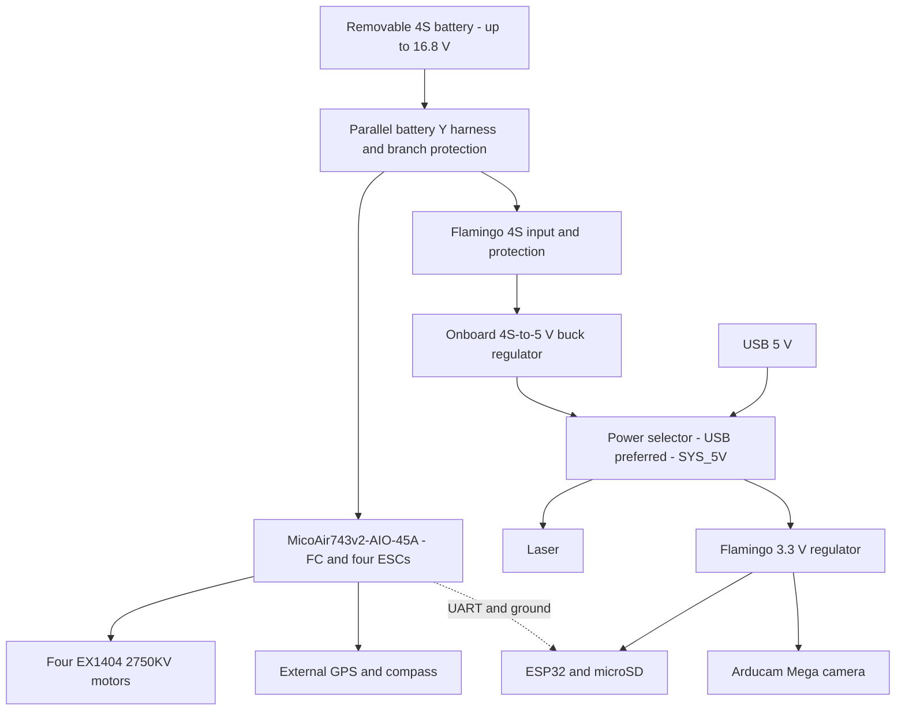

# Flamingo components and design plan

Updated: 2026-11-15.

Start with the [sheet-by-sheet schematic build plan](SCHEMATIC_BUILD_PLAN.md). Library import instructions: [EasyEDA project library](libraries/EasyEDA/README.md).

Flamingo detects a colored 16 x 16 m tarp from approximately 1 km. It handles the camera, laser and payload logging; a separate flight controller supplies navigation and flight control. This document records the selected architecture and proposed parts. Schematic work and hardware validation are still pending.

Camera: Arducam Mega 5MP autofocus SPI; see [camera wiring](COMPONENTS.md#camera-and-image-processing).

## Current decisions

**Camera update, 2026-11-15:** Arducam Mega SPI replaces Adafruit DVP.

- **Processor:** ESP32-S3-WROOM-1-N16R8, with 8 MB PSRAM and 16 MB flash.
- **Camera:** Arducam Mega 5MP autofocus, Amazon B0BW7MDVHK, off-board six-wire SPI connection.
- **Flight controller and ESCs:** [MicoAir743v2-AIO-45A](https://store.micoair.com/product/micoair743v2-aio-45a/), with an external M10G-5883 GPS/compass. Replaces the NxtPX4 V2 and separate ESC board.
- **Motors:** four [Happymodel EX1404 2750KV](https://www.happymodel.cn/index.php/2021/01/07/happymodel-ex1404-kv2750-kv3500-kv4800-brushless-motor/) brushless motors. Propellers remain to select; thrust and runtime need validation.
- **Laser:** module described as STA-M020X in the supplied SAT-M020X PDF; 5 V supply and default 3.3 V UART.
- **Power:** one removable **4S LiPo** shared by the AIO and Flamingo. An onboard 4S-to-5 V buck on Flamingo supplies its electronics and the laser; motor power stays off Flamingo. Charge the pack externally; no built-in charging.
- **Images:** capture JPEG and decode sequential blocks into a reusable buffer.
- **Size:** plan around 50 x 80 mm for Flamingo; maximum 50 x 100 mm. This is an allowance, not a completed placement.

## Power

Use a standard **4S LiPo: 14.8 V nominal, 16.8 V fully charged**. The selected AIO accepts 3-6S. Split battery power outside Flamingo between the AIO and Flamingo's 4S input. Flamingo's Power sheet will include input protection and the 4S-to-5 V converter. Battery capacity, discharge rating, connectors and runtime must include all four motors and electronics.



All boards share ground. Motor battery and return currents use the AIO's rated power wiring, not Flamingo traces or signal cables. The AIO and Flamingo use separate regulator branches; Flamingo does not depend on the AIO's accessory output. A shared battery is still a common point of failure.

| Power item | Plan |
|---|---|
| Battery and charging | Removable standard 4S pack and a compatible external 4S balance charger. No charger on Flamingo. |
| Flight controller and motors | 4S branch to AIO VBAT/GND; its four ESC channels drive the motors. The AIO 5 V / 2 A output supplies suitable FC peripherals. No separate ESC board is needed. |
| Flamingo input | Raw 4S/GND enters Flamingo as VBAT_4S, then input protection and an onboard buck produce BUCK_5V. All battery-side parts must withstand 16.8 V plus transients; target a regulator operating input rating of at least 24 V with suitable protection. Exact regulator/support parts and current budget need review; motor current bypasses Flamingo. |
| Main 3.3 V rail | ESP32 and microSD; camera supply/regulator load must be added after the restored DVP power interface is specified. |
| Camera rails and logic | Complete breakout handles sensor supplies; host uses regulated 3.3V and direct CAM_* nets. |
| Laser rail | SYS_5V after the source selector, available from USB or the onboard buck. Datasheet specifies 3-5 V input, recommends 5 V and lists peak power <=0.55 W, equivalent to 110 mA at 5 V. Size with margin and verify startup pulses and voltage tolerance. |
| USB power | Select USB_VBUS or BUCK_5V with reverse-current blocking to produce SYS_5V. Prefer USB when present; otherwise use the onboard buck. SYS_5V supplies the laser, main 3.3 V regulator (including camera load), with no physical payload switch. Size the USB source, current/inrush protection and selector for the combined load; full operation is conditional on adequate USB current. Keep USB from backfeeding the battery/buck or AIO. USB does not power the flight controller or motors. |
| Protection | Select connector, branch protection, reverse-polarity protection and battery low-voltage handling with the actual pack and loads. |

**Remove from the planned BOM:** BQ24074 charger, its charging-current/termination/timer/NTC network, and charging-status circuitry. The old single-cell battery-to-charger-OUT power path is superseded. Existing copied CAD has not been edited.

The current downstream 3.3 V candidate is TPS62162DSGR; see POWER_PARTS.md. The earlier TPS63070 option was **only for the downstream 5 V to 3.3 V stage**. Its maximum operating input is 16 V, below a full 4S pack: **do not connect it directly to 4S or use it as the 4S-to-5 V buck**. A buck-only regulator may be simpler for 5 V to 3.3 V. Review support circuits and the load budget before selecting either regulator. Pelican's TPS61023 boost is not required for the laser rail.

Sources: [AIO manual](https://micoair.com/en/docs/flight-controller/micoair743-aio-series/micoair743v2-aio-45a-manual), [motor specifications](https://www.happymodel.cn/index.php/2021/01/07/happymodel-ex1404-kv2750-kv3500-kv4800-brushless-motor/), [TPS63070 specifications](https://www.ti.com/product/TPS63070), and the supplied laser manual, pp. 2-3.

### Single battery connector

Use an **XT30 parallel Y harness** matching the battery's main connector. XT30 is the selected cable connector family; verify mating genders and polarity against the actual pack and harness. Split both positive and negative wires: one pair to AIO BATTERY+/BATTERY-, the other to Flamingo's 4S input connector. Both legs carry full battery voltage (up to 16.8 V); Flamingo's onboard buck reduces its branch to 5 V. A second battery or custom distribution PCB is not required.

```text
Battery XT30 connector -> XT30 parallel Y harness
                         |-> AIO battery pads -> four motors
                         |                     -> 5 V for GPS/receiver
                         |-> Flamingo 4S input -> onboard buck -> electronics/laser
```

Match connector polarity and rate the inlet/AIO leg for the motor load; size and protect the Flamingo leg separately. Use the main discharge connector, not the balance lead. Keep motor current out of Flamingo. Do not assume the AIO current sensor includes the separate Flamingo branch when estimating total battery consumption.

### Candidate 4S input protection BOM

For the first prototype, have JLCPCB assemble the SS34; hand-solder the fuse, TVS and the 47uF capacitor C8. This replaces the earlier AO3401A MOSFET, gate-zener and gate-resistor proposal with a series Schottky diode. These are candidate parts, pending the load, fault-current and transient review.

| Function | Part / specification | JLCPCB / LCSC | Assembly plan |
|---|---|---|---|
| Resettable fuse | Bourns MF-R160; 30 V, 1.6 A hold / 3.2 A trip at 23 C | [C208483](https://jlcpcb.com/partdetail/C208483) | Extended listing; radial through-hole, hand-solder. |
| Reverse-polarity diode | MDD SS34; 40 V, 3 A, SMA/DO-214AC | [C8678](https://jlcpcb.com/partdetail/C8678) | Basic; have JLCPCB assemble. |
| Surge suppressor | SMC P6KE20A; unidirectional, 17.1 V standoff, rated clamp 27.7 V, DO-15 | [C499762](https://jlcpcb.com/partdetail/C499762) | Extended listing; axial through-hole, hand-solder. |
| Input bulk capacitor | C8: existing 47uF capacitor, at least 35V | User-supplied; no exact purchase MPN required | Hand-solder; omit from JLC assembly selection. Match its actual package during layout and observe polarity if electrolytic. |

```text
XT30 positive -> MF-R160 -> SS34 -> VBAT_PROT -> TPS54302 VIN
                                      |-> P6KE20A -> GND
                                      |-> 47 uF / 35 V -> GND
XT30 negative --------------------------> GND
```

C8 will use the user's existing 47uF capacitor; match the physical part during layout rather than requiring the earlier Panasonic SMD candidate. It provides input bulk capacitance and damping; the buck still needs its separate ceramic input capacitors. C8 is 47 uF / 35 V, not a TPS2116 local bypass capacitor.

SS34's cathode/banded end faces VBAT_PROT. The TVS cathode/banded end also connects to VBAT_PROT; its anode connects to GND. The capacitor positive terminal connects to VBAT_PROT. Keep the buck's required ceramic input capacitors as well; the electrolytic supplements them.

**Assembly cost:** among the capacitors, only C8 (47uF) is hand-soldered and excluded from JLC assembly selection/BOM/CPL. Keep C8 in the full BOM and retain its PCB pads. C11 is the user-selected 100uF non-polarized part and is not excluded on hand-soldering grounds. The earlier separate fuse/TVS assembly plan is unchanged. The fuse and TVS retain their Extended catalog classification but incur no Extended assembly setup fees if JLC does not fit them. JLC's assembly inventory cannot be shipped as loose parts.

**DigiKey purchasing links for the hand-soldered protection parts:**

| Function | Exact part link | Purchasing note |
|---|---|---|
| Resettable fuse | [Bourns MF-R160](https://www.digikey.com/en/products/detail/bourns-inc/MF-R160/259972) | Exact BOM part; listed in stock when checked 2026-11-14. |
| TVS | [SMC P6KE20A](https://www.digikey.com/en/products/detail/smc-diode-solutions/P6KE20A/5993387) | Exact BOM manufacturer/part, but not normally stocked at DigiKey. [Littelfuse P6KE20A](https://www.digikey.com/en/products/detail/littelfuse-inc/P6KE20A/285930) was listed in stock in single quantities; alternate manufacturer, same listed 17.1 V standoff / 27.7 V clamp and DO-15 family. Confirm its dimensions and transient ratings before substitution. |
| Bulk capacitor | Existing 47uF capacitor, at least 35V | User-supplied and hand-soldered; no purchase MPN required. |

These links supplement the JLC/LCSC references; the alternates have not silently replaced the original BOM entries. Availability is subject to change. Use DigiKey for these individual electronic components; an Adafruit module is not needed for this circuit.

**Availability checked 2026-11-14:** the fuse, SS34 and TVS JLC listings showed positive assembly stock; C499762 had only nine available. This is a dated stock observation, not a reservation or confirmation of separately shippable distributor stock. Recheck before ordering. C8 now uses an existing user-supplied 47uF capacitor; the earlier Panasonic candidate is no longer a required purchase.

**Tradeoff and remaining work:** the SS34 drops some voltage and dissipates heat (for example, 0.5 A x 0.4 V = 0.2 W). Finalize battery-side load current, PTC temperature derating, diode cooling and TVS/layout behavior. The PTC has a 40 A maximum fault-current rating and is not automatically a substitute for a properly rated fuse near the LiPo in Flamingo's branch. The TVS's rated clamp is not a guarantee that every transient stays below the buck's limit. This circuit does not provide battery undervoltage cutoff or controlled inrush; those remain separate design decisions.

**Do not use the earlier quoted C-number substitutions:** C369156 is a 160 mA-hold PTC, C70072 is a 350 mA/16 V PTC, C8056 is a 3.3 V zener, C72482 is a 10 uF/100 V capacitor, and C134738 is a 470 uF/6.3 V capacitor. They do not match the originally quoted descriptions. SMAJ22A is not an interchangeable TVS choice: its rated clamp is about 35.5 V, above the TPS54302's 30 V absolute maximum input.

References: [Bourns MF-R datasheet](https://www.bourns.com/docs/product-datasheets/mfr.pdf), [SS34 listing and specifications](https://jlcpcb.com/partdetail/C8678), [SMC P6KE20A specifications](https://www.lcsc.com/product-detail/C499762.html), and [TPS54302 limits](https://www.ti.com/lit/ds/symlink/tps54302.pdf).

## Components

JLC links identify catalog entries. Recheck stock, price and assembly eligibility before ordering; earlier stock checks are not current guarantees.

| Function | Part / source | Status and notes |
|---|---|---|
| ESP32 module | ESP32-S3-WROOM-1-N16R8 - [C2913202](https://jlcpcb.com/partdetail/C2913202) | Selected. 8 MB Octal PSRAM, 16 MB flash, Wi-Fi/BLE, antenna and 40 MHz crystal included. 3.3 V supply; body 18 x 25.5 x 3.1 mm. KiCad family: `RF_Module:ESP32-S3-WROOM-1`; use the complete ordering code as its value. |
| Flight controller + ESCs | [MicoAir743v2-AIO-45A](https://store.micoair.com/product/micoair743v2-aio-45a/) | Selected. H743, dual BMI088/BMI270 IMUs, SPL06 barometer, microSD; four 45 A AM32 ESCs (cooling dependent). Listed $74.99 before shipping/tax on 2026-11-14; stock/delivery not confirmed. ArduPilot/PX4; no onboard GPS/compass. |
| Motors | Four [Happymodel EX1404 2750KV](https://www.happymodel.cn/index.php/2021/01/07/happymodel-ex1404-kv2750-kv3500-kv4800-brushless-motor/) | Selected 4S brushless motors; three phase wires per motor connect to its AIO ESC channel. Props and total vehicle thrust remain unvalidated. |
| GPS/compass | [MicoAir M10G-5883](https://store.micoair.com/product/m9-m10-gps-module/) | Retained: 5 V module with UBX UART GPS and QMC5883L I2C compass. Connect to AIO UART3 / GPS1 (ArduPilot SERIAL3) plus I2C. See wiring below; Flamingo gets navigation over telemetry. |
| Camera | Arducam Mega 5MP autofocus B0BW7MDVHK | Dedicated SPI GPIO7-10, off-board |
| Camera connector / supplies | J5 1x6 2.54mm, +3V3/GND, R20 | Connect by module labels |
| Laser | STA-M020X per supplied manual | External module; confirm actual label matches the manual. About 14 g, diameter 23 x 47 mm. |
| microSD socket | XUNPU TF-115-BCP9 - [C720505](https://jlcpcb.com/partdetail/Xunpu-TF_115BCP9/C720505) | Placed as J2, 3.3 V SPI. `EasyEDA:TF-SMD_TF-115-BCP9`; R1-R5 are five 10k pull-ups, 0805 / C17414. CD pin 9 intentionally unused; VSS and shell contacts grounded. Local decoupling and parent-sheet SPI connections remain. |
| USB-C | DEALON USB-TYPE-C-017 - [C2927037](https://jlcpcb.com/partdetail/DEALON-USB_TYPE_C017/C2927037) | Placed on USB programming / JTAG sheet; right-angle SMT, 16 contacts. Assigned footprint `EasyEDA:USB-TYPE-C-SMD_C9900008089` must be checked against this exact MPN. CC pull-downs and paired D+/D- contacts are drawn; ESD/input protection remain. |
| USB ESD | ST USBLC6-2SC6 - [C7519](https://jlcpcb.com/partdetail/C7519) | Proposed; check ST pinout and VBUS/ground treatment. |
| Battery splitter/harness | XT30 parallel Y harness; mating genders to match the actual pack/cables | One battery input, separate AIO and Flamingo 4S branches; verify polarity, current ratings and branch protection. |
| Onboard 5 V buck | TPS54302DDCR - [C311983](https://jlcpcb.com/partdetail/C311983) | Placed in `schematics/schematics/buck4S_5V.kicad_sch` with a preliminary support circuit; electrical/part-rating validation remains. 4.5-28 V input, up to 3 A. Prior positive JLC stock check; recheck before ordering. |
| Main 3.3 V regulator | Current candidate TPS62162DSGR - [C40256](https://jlcpcb.com/partdetail/C40256) | Placed as U3, fixed 3.3 V, 1 A from global `5V` to global `3V3`, with preliminary 2.2 uH, 10 uF, 22 uF and 100k PG support. EP, AGND, PGND and FB are grounded. Verify inductor selection and combined peak-load budget. Supersedes TPS63070 as the current placement candidate; see POWER_PARTS.md. |
| USB/buck power selector | TPS2116DRLR - [C3235557](https://jlcpcb.com/partdetail/C3235557) | Placed as U2: USB_5V to VIN1, Buck_5V to VIN2, MODE to VIN1; PR1 divider drawn with intended 33k/10k values. Both outputs join global `5V`. Local mux capacitors C9-C11 are drawn; USB protection remains; passive values are now explicit; part numbers/ratings still need review. |
| Connectors | Camera, laser, FC telemetry, 4S input and expansion | Flamingo 4S input: XT30PW-M30.G.Y, [C431092](https://jlcpcb.com/partdetail/C431092), through-hole/right-angle. Imported as `EasyEDA:XT30PW-M` with `EasyEDA:CONN-TH_XT30PW-M`. Confirm actual harness polarity/mating gender. Other connector choices and contact order remain to settle. |

## GPS compatibility and wiring

**Keep MicoAir M10G-5883.** Its documented interfaces match the AIO: UART3/GPS1 and I2C1, powered from AIO 5 V. The ArduPilot MicoAir743v2 target explicitly probes external QMC5883L compasses. This verifies documented interface/driver compatibility; hardware operation and the received cable remain untested.

| GPS signal | Connect to AIO |
|---|---|
| 5V | 5 V GPS supply; never raw 4S or 12 V |
| GND | GND |
| Tx | RX3 |
| Rx | TX3 |
| SCL | SCL |
| SDA | SDA |

The GPS uses an SH1.0-6P connector. Compare both manufacturer's diagrams and verify every cable contact; six contacts alone do not guarantee matching wire order. Keep the GPS/compass away from motor wiring. Confirm GPS fix and compass detection/calibration after assembly. UART4 remains available for Flamingo.

Sources: [GPS manual](https://micoair.com/en/docs/gps-rtk/gps), [GPS connector diagram](https://micoair.com/api/media/file/docs/2026/10/m10g-5883-b5436efbc2.webp), [AIO connector diagram](https://micoair.com/api/media/file/docs/2026/10/micoair743v2-aio-ports-cdd4b57446.webp), and [ArduPilot hardware definition](https://github.com/ArduPilot/ardupilot/blob/master/libraries/AP_HAL_ChibiOS/hwdef/MicoAir743v2/hwdef.dat).

## Laser interface

Source: [supplied SAT-M020X LRF Module.pdf](<C:/Users/sikap/Downloads/SAT-M020X LRF Module.pdf>), pp. 2-3 and 7-9. The document itself calls the model **STA-M020X**.

| Property | Datasheet value / design implication |
|---|---|
| Power | 3-5 V input; 5 V recommended. Operating current <=90 mA, standby <=20 mA, peak power <=0.55 W. Current and power figures are not fully consistent; verify real startup/measurement demand. |
| Serial logic | TTL UART; factory I/O voltage 3.3 V, configurable. Direct S3 UART is the candidate interface at the confirmed 3.3 V setting. Supply voltage and UART logic voltage are separate. |
| Defaults | 19200 baud, slave address `0x10`, automatic result output after ranging. Confirm serial framing and actual settings on the received unit. |
| Range / rate | 5 m minimum; advertised 2000 m for buildings and 1500 m for trees; 1-3 Hz. Tarp range in daylight still needs testing. |
| Accuracy | Manual claims +/-1 m; 0.1 m data steps are resolution, not 0.1 m accuracy. |

The **module connector has five pins**, not six. The earlier six-way carrier connector request can be retained with an unused sixth contact and a suitable harness, but the exact connectors are not selected.

| Module contact | Signal | Proposed Flamingo connection |
|---|---|---|
| 1 | GND | Common ground |
| 2 | Vin | Regulated 5 V laser supply |
| 3 | TXD, output from laser | GPIO39 / ESP32 UART RX |
| 4 | RXD, input to laser | GPIO38 / ESP32 UART TX |
| 5 | ENO, enable/reserved | Leave unconnected pending manufacturer clarification |

Confirm connector pitch, pin-1 orientation and harness continuity before drawing a numbered carrier connector. Do not infer ENO voltage, polarity or pull requirements from its name.

Protocol starting point: frames are `SlaveID + command + parameters + checksum`. The checksum is the negative sum of command/parameter bytes modulo 256; exclude SlaveID. Verified manual examples: communication test `10 C0 40`; continuous ranging in meters `10 83 40 3D`. Check result validity, unit and resolution bits before interpreting distance. Some manual examples/labels contain inconsistencies; test parsing against the actual module.

## Camera and image processing


Selected camera: [Arducam Mega 5MP autofocus, Amazon B0BW7MDVHK](https://www.amazon.com/dp/B0BW7MDVHK). User reports $35 and available on 2026-11-15. This replaces the Adafruit DVP and Seeed bare-flex designs.

### Wiring

J5 is a standard 1x6 2.54mm host header. Use a short detachable six-wire cable and connect to the camera's printed labels. Host pin numbers below do not establish the physical camera connector order; verify the supplied cable/module before power.

| J5 host pin | Net | Camera label | ESP32 GPIO |
|---|---|---|---|
| 1 | +3V3 | VCC | - |
| 2 | GND | GND | - |
| 3 | CAM_SCK | SCK | 8 |
| 4 | CAM_MISO | MISO | 9 |
| 5 | CAM_MOSI | MOSI | 10 |
| 6 | CAM_CS | CS | 7 |

Dedicated SPI keeps camera traffic separate from the SD bus. R20 (10k) pulls CS to +3V3 while the MCU boots. J5 and R20 are the entire camera sheet. The breakout provides its own decoupling; host camera capacitors are omitted. No external sensor regulators, level translators, SCCB pull-ups, reset or XCLK circuits remain. Exact locking connector purchasing part is not selected; the assigned footprint is a standard 1x6 2.54mm pin header.

### GPIO available

Camera uses GPIO7-10. Freed from DVP: GPIO4,5,6,11-18,21 (12 pins). Including43/44/48, unrestricted unallocated pins total15. GPIO43/44 remain available for general use. GPIO0/3/45/46 have strapping constraints;35-37 are occupied by N16R8 PSRAM. USB19/20, telemetry1/2, laser38/39 and SD40/41/42/47 keep their allocations. Freed core pins are intentionally left unconnected for future use.

### Firmware and verification

Use the Arducam Mega SDK, not the esp32-camera DVP driver. SPI mode0; start slowly and validate up to the manufacturer-recommended8MHz. Observe its CS transaction and burst-read dummy-byte rules. Test identity, JPEG capture/readout and autofocus. Read compressed JPEG into PSRAM or stream it; decode blocks using a reusable buffer. Full5MP RGB565 requires10,077,696 bytes and exceeds8MiB PSRAM.

Check total3.3V current including autofocus, ESP32 and SD. Secure and strain-relieve the cable. Capture/transfer latency, hardware operation and PCB routing remain unverified. The four SPI signals use hierarchical ports through the parent schematic; camera power and ground also enter through hierarchical ports. Whole-project ERC remains unfinished.

### Sources

- [Arducam Mega5MP](https://docs.arducam.com/Arduino-SPI-camera/MEGA-SPI/MEGA-5MP/)
- [3.3V wiring examples](https://docs.arducam.com/Arduino-SPI-camera/MEGA-SPI/MEGA-Quick-Start-Guide/)
- [Manufacturer SPI application note](https://cdn.arducam.com/downloads/datasheet/Arducam_MEGA_SPI_Camera_Application_Note.pdf)

## GPIO allocation

Unallocated GPIOs: 4/5/6,11-18,21,43/44/48. GPIO43/44 remain available for general use. GPIO0/3/45/46 are strapping pins, not unrestricted spares. See [Camera interface](COMPONENTS.md#camera-and-image-processing).

Camera SPI hierarchical connections and USB, SD and laser core labels are drawn; telemetry and expansion remain planned. Parent USB-data/SD links and hardware/firmware validation are still pending.

| Interface | GPIOs / notes |
|---|---|
| Camera SPI | GPIO7 CS,8 SCK,9 MISO,10 MOSI; hierarchical connections through the parent sheet. |
| USB Serial/JTAG | 19 D-, 20 D+ |
| FC telemetry | 1 TX -> AIO UART4 RX; 2 RX <- UART4 TX; common ground. PX4 TELEM2 / ArduPilot SERIAL4. |
| Laser UART | 38 TX -> laser RXD; 39 RX <- laser TXD |
| Shared SPI | 40 SCLK, 41 MOSI, 42 MISO |
| microSD CS | 47; pull up for startup |
| Expansion SPI CS | 48 available; currently unconnected |
| Expansion constraints | Camera uses GPIO7-10. Proposed diagnostics reserves21,43/44 and optionally18; see build plan. |
| Boot/strapping | 0, 3, 45, 46; review startup loads, reserve GPIO0 for BOOT |
| PSRAM occupied | 35, 36, 37 unavailable |

GPIO47/48 are 3.3 V in this N16R8 plan. Use USB JTAG; GPIO39-42 are already assigned elsewhere. GPIO4/5 are available for3.3V expansion I2C; coordinate bus pull-ups. Initialize SD into SPI mode before other devices use the shared bus; each device needs its own CS and must release MISO. [SD/SPI sharing guide](https://docs.espressif.com/projects/esp-idf/en/stable/esp32s3/api-reference/peripherals/sdspi_share.html)

## Flight-controller link

### AIO UART4 socket wiring and power

Use the FC's UART4 socket shown in the manufacturer's port diagram. Its displayed contact order is RX4, TX4, 5V, GND; this is a diagram-view order, not a verified numbered mating-cable drawing.

| FC socket label | Connect on Flamingo |
|---|---|
| RX4 | GPIO1 TX / FC_UART_TX |
| TX4 | GPIO2 RX / FC_UART_RX |
| 5V | Leave unconnected; omit this conductor or insulate the unused end |
| GND | GND |

The 4S pack powers the FC at its main battery input; the FC generates its own regulated 5V peripheral output. Flamingo continues to use its own 4S-to-5V buck and USB/buck selector. Do not join the FC socket's 5V to Flamingo's regulated rails: that would parallel separate supplies and could backfeed the FC when Flamingo is USB-powered. The UART cable carries TX, RX and a dedicated ground return only. Shared ground through the battery harness does not eliminate the planned signal-ground conductor.

Use the planned four-contact Flamingo socket and matching cable, leaving the contact corresponding to FC 5V unconnected on Flamingo; see the connector section below. The included packing-list confirms SH1.0-4P cable family; verify pin-1/view orientation, cable continuity and the other-end termination before final wiring. UART4 is SERIAL4 in ArduPilot and TELEM2 in PX4.

Source: [manufacturer board specifications and UART mapping](https://micoair.com/flightcontroller_micoair743v2_aio_45a/), plus the UART4 port diagram supplied in this conversation. No change to schematic net names or board power architecture.


Use **AIO UART4** and non-inverted 3.3 V UART; verify the actual pads/connector and logic levels before wiring. In ArduPilot use **`SERIAL4`**, with MAVLink 2 (`SERIAL4_PROTOCOL = 2`), initially 115200 baud, 8N1. PX4 calls UART4 TELEM2; configure its MAVLink instance if using PX4.

Connect AIO UART4 TX to Flamingo GPIO2 RX, UART4 RX to GPIO1 TX, and GND to GND. Use TX/RX/GND only on this cable because Flamingo has its own regulator branch.

Keep GPS on **AIO UART3 / GPS1 (ArduPilot SERIAL3)**, with compass on external I2C. Firmware targets: `MicoAir743v2` for ArduPilot; `micoair_h743-v2` for PX4. Select the exact v2 target rather than the older similarly named AIO target. Request position, attitude, GNSS quality, health and timestamps using `GLOBAL_POSITION_INT`, `ATTITUDE` or `ATTITUDE_QUATERNION`, `GPS_RAW_INT`, `HEARTBEAT`, `SYS_STATUS` and appropriate time-sync messages. Use `MAV_CMD_SET_MESSAGE_INTERVAL` and measure actual delivered rates. Reject stale or invalid navigation data.

GPS/barometric altitude is not automatically height above terrain; laser distance is along its beam. Locating the tarp also needs camera calibration, mounting alignment, attitude, geometry and synchronized measurements. Validate the vehicle-specific ArduPilot build and features; board support alone does not establish suitability for rocket ascent or deployment.

References: [AIO manual and port mapping](https://micoair.com/en/docs/flight-controller/micoair743-aio-series/micoair743v2-aio-45a-manual), [official ArduCopter firmware](https://firmware.ardupilot.org/Copter/stable/MicoAir743v2/), [GPS manual](https://micoair.com/en/docs/gps-rtk/gps), [ArduPilot serial configuration](https://ardupilot.org/copter/docs/common-serial-options.html), [message requests](https://ardupilot.org/dev/docs/mavlink-requesting-data.html).

### Four-contact UART4 connector and cable selection

This supersedes the earlier three-contact Micro-Fit proposal. Use the confirmed four-contact JST-SH 1.0mm-pitch connection, with only TX, RX and GND electrically used. The 5V position is deliberately unconnected on Flamingo.

| Item | Selection |
|---|---|
| Flamingo PCB socket | JST **SM04B-SRSS-TB(LF)(SN)**, four contacts, 1.0mm pitch, right-angle SMT; [JLC C160404](https://jlcpcb.com/partdetail/JST-SM04B_SRSS_TB_LF_SN/C160404), Extended, Economic/Standard SMT assembly |
| KiCad symbol | `Connector_Generic:Conn_01x04`; assign a free reference |
| KiCad footprint | `Connector_JST:JST_SH_SM04B-SRSS-TB_1x04-1MP_P1.00mm_Horizontal` (available in the installed library) |
| Cable | Included **SH1.0-4P cable, 15cm**, identified in the user-supplied FC packing-list image. Reuse this cable; no separate cable purchase planned. Inspect whether its Flamingo end is already terminated or needs an SH four-contact housing/contacts |
| Plug housing if making a harness | JST SHR-04V-S family, with matching SH crimp contacts sized for the chosen wire; a finished cable avoids hand-crimping tiny contacts |

**Connector family confirmed:** the user-supplied packing-list image explicitly identifies the included lead as **SH1.0-4P Cable 15cm (For FC) x1**. This confirms the SH 1.0mm / four-contact family for the included cable and supports the selected JST SM04B-SRSS-TB socket. Use the supplied lead. Its end-to-end contact numbering and termination at the Flamingo end still need inspection; the packing-list text alone does not prove both ends are preterminated or give a pin map.

| FC UART4 signal | Flamingo connection |
|---|---|
| RX4 | GPIO1 TX / FC_UART_TX |
| TX4 | GPIO2 RX / FC_UART_RX |
| 5V | Corresponding Flamingo pad no-connect; never tie to Flamingo's power rails |
| GND | GND |

Do not assign numbered Flamingo pads from the screenshot's vertical order alone. Use a continuity test on the actual cable to map the FC contacts to the selected PCB connector's pad numbers. Preserve TX-to-RX crossing electrically. Qwiic/STEMMA QT is the cable's usual application, not the UART wiring standard: do not use its usual power/I2C color convention as the FC pinout. With this socket/cable used for UART, clearly label it UART so it is not mistaken for an I2C expansion port.

JST-SH uses friction retention rather than the positive latch of Micro-Fit. Use suitable cable restraint during layout/mechanical work. The SH board socket is 1mm SMT and is best factory-assembled; it is not the earlier easy-through-hole-solder option. JLC assembly stock was not exposed by the readable listing; the cable stock observation is not JLC inventory confirmation. A separate Adafruit cable is no longer required; use the included 150mm lead.

Sources: [JST SH family](https://www.jst-mfg.com/product/index.php?lang=en&series=231), [FC manual](https://micoair.com/en/docs/flight-controller/micoair743-aio-series/micoair743v2-aio-45a-manual), [JLC socket](https://jlcpcb.com/partdetail/JST-SM04B_SRSS_TB_LF_SN/C160404), [finished cable](https://www.adafruit.com/product/5384).


## Saved KiCad state - 2026-11-15

The saved diagram is the source for this implementation snapshot; planned architecture elsewhere is not a completed circuit. Net names and port definitions have been preserved as requested. Actual saved global rails are `5V` and `3V3`, with local `Buck_5V` and the existing battery/buck child port names. Architecture names SYS_5V/+3V3 elsewhere describe their intended roles, not additional connected CAD nets.

| Block | Drawn | Still required |
|---|---|---|
| Input / buck | J4 XT30, F1 MF-R160, D2 SS34, D1 P6KE20A, C8 47uF; U4 TPS54302 with preliminary support | Review exact protection/capacitor selection, ratings, feedback values and startup/cutoff behavior |
| Source selector | TPS2116, USB on VIN1 and buck on VIN2; MODE/PR1 priority network; C9/C10 4.7uF and C11 100uF local bypass (C11 non-polarized, selected by user) | USB input protection, close PCB placement, inrush/switchover validation |
| 3.3 V | TPS62162 and preliminary support; EP grounded | Resolve L1/L2: both cite C1046 despite intended values of 2.2uH and 10uH; select correctly rated separate power inductors. Finish load/transient review |
| USB | DEALON connector, two CC pull-downs, joined D+ and D- copies | Shell pins 1-4 still unconnected; ESD, input protection and top-level data wiring. R6/R7 now have explicit 5.1k values and `R_0402_1005Metric` footprints matching C25905 |
| Core | ESP32, 3V3/GND, SD/USB/laser signal labels | EN/BOOT/reset support and decoupling; finish parent-sheet interfaces. USB data ports still need bidirectional definitions when that interface is finished |
| Camera | Arducam Mega 5MP autofocus B0BW7MDVHK | Dedicated SPI GPIO7-10, off-board |
| microSD | J2 socket; R1 DAT2, R2 CS, R3 MOSI, R4 MISO, R5 DAT1; all 10k / C17414 | Local decoupling and top-level SD wiring; SPI sharing with expansion remains planned |

### Reference and naming cleanup

All populated active sheets now use unique component references and explicit passive values. Net names, hierarchical port names/directions and sheet names are preserved. The original component UUIDs were preserved; update the PCB from the schematic to apply reference changes. The USB CC resistor footprint mismatch was corrected to match the retained C25905 part; other footprint choices still require review.

| References | Function / value |
|---|---|
| U1 / U2 / U3 / U4 | ESP32-S3 / TPS2116 / TPS62162DSGR / TPS54302DDCR |
| J1 / J2 / J3 / J4 | Laser / microSD / USB-C / XT30 battery input |
| R1-R5 | microSD pull-ups, 10k |
| R6-R7 | USB CC pull-downs, 5.1k |
| R8 / R9 / R10 | PR1 bottom 10k / PR1 top 33k / PG pull-up 100k |
| R11-R12 | Buck feedback 10k / 75k; verify final output setting |
| L1 / L2 | Intended 2.2uH / 10uH; conflicting C1046 selection needs correction |
| C1-C2 | 3.3 V stage 10uF / 22uF |
| C3-C7 | Buck 10uF, 22uF, 22uF, 0.1uF, 0.1uF |
| C8 / F1 / D1 / D2 | User-supplied, hand-soldered 47uF bulk capacitor / fuse / TVS / polarity diode |
| C9-C10 / C11 | TPS2116 inputs 4.7uF each, Basic 0805 / output 100uF non-polarized, selected by user |

**Laser wiring discrepancy to resolve:** LASER_TX/GPIO38 currently reaches J1 pin 3, while the supplied manual identifies pin 3 as module TXD. LASER_RX/GPIO39 reaches J1 pin 4, identified as module RXD. Review/cross those connections before hardware release; naming cleanup preserved the existing topology.

### Capacitor audit - 2026-11-15

Preference: use 0805 ceramics where electrically suitable. Checked against the current saved drawing and JLC part specifications; no net names or capacitor values changed during this audit. The user has corrected C6/C7 and C3, and selected a non-polarized 100uF C11. Power verification is recorded as complete by the user, pending one final electrical check and layout.

| Reference | Current value | Selected part | Rating / package | Audit result |
|---|---|---|---|---|
| C1 | 10uF | Samsung CL21A106KAYNNNE / [C15850](https://jlcpcb.com/partdetail/C15850) | 25V X5R, +/-10%, 0805 | Value/package match; 5V rail |
| C2, C4, C5 | 22uF | Samsung CL21A226MAQNNNE / [C45783](https://jlcpcb.com/partdetail/C45783) | 25V X5R, +/-20%, 0805 | Value/package match; 3.3V/5V outputs |
| C3 | 10uF | Replacement selected and corrected by user | User-verified | Resolved; include in final electrical check |
| C6, C7 | 0.1uF | Samsung CL21B104KCFNNNE / [C28233](https://jlcpcb.com/partdetail/C28233) | 100V X7R, +/-10%, 0805 | User correction verified; replaces incorrect 1uF C28323 assignment |
| C8 | 47uF | Existing user-supplied part; no required purchase MPN | At least 35V; actual package during layout | Only capacitor planned for hand soldering |
| C9, C10 | 4.7uF | Samsung CL21A475KAQNNNE / [C1779](https://jlcpcb.com/partdetail/C1779) | 25V X5R, +/-10%, 0805 | Match; user's current TPS2116 input bypass values retained |
| C11 | 100uF non-polarized | User has found/selected the part | Match selected part during layout | Not hand-soldered; include in factory assembly selection |

The verified ceramic selections above are listed Basic by JLC. These checks establish nominal value/rating/package agreement, not measured regulator stability or current assembly stock. C3 replacement is resolved per the user; confirm the final saved part/voltage rating in the last electrical check.

TPS2116 C9/C10 connect VIN1/VIN2 to GND. C11 connects the joined VOUT pins to GND; the selected part is non-polarized. Reconcile the symbol and selected package during the final schematic/layout pass. Keep the capacitors physically close to U2. The user's latest 100uF output replaces the earlier 10uF proposal. TI's typical application also uses 100uF; its ideal capacitive startup current at 5V with 1.7ms soft-start is about 294mA before other downstream capacitance and load. Verify USB inrush and switchover droop with the complete load.

The 22uF and 10uF ceramic effective values decrease with DC bias. Check manufacturer characteristic data and regulator minimum capacitance before final release. C8 remains the only hand-soldered capacitor, using an existing 47uF part rated at least 35V. C11 is the selected 100uF non-polarized factory-assembled part.

References: [TPS2116 datasheet, sections 8-10](https://www.ti.com/lit/ds/symlink/tps2116.pdf).

### microSD connection record

| Socket pin | Signal | Saved sheet connection |
|---|---|---|
| 1 | DAT2 | R1 pull-up to 3V3; no core GPIO |
| 2 | CD/DAT3 | SD_CS input; R2 pull-up; intended GPIO47 |
| 3 | CMD | SD_MOSI input; R3 pull-up; intended GPIO41 |
| 4 | VDD | 3V3 |
| 5 | CLK | SD_CLK input, no pull-up; intended GPIO40 |
| 6 | VSS | GND |
| 7 | DAT0 | SD_MISO output; R4 pull-up; intended GPIO42 |
| 8 | DAT1 | R5 pull-up to 3V3; no core GPIO |
| 9 | Mechanical CD | Explicit no-connect; card detection by initialization |
| 10-13 | Shell / ground | GND |

The five pull-ups retain their existing 0805 footprints and C17414 purchasing fields. The parent-sheet grid correction now connects all four SD signals to the intended ESP32 pads; checked in the exported netlist.

## Unfinished interface build instructions

Detailed sheet-by-sheet work has been restored in [SCHEMATIC_BUILD_PLAN.md](SCHEMATIC_BUILD_PLAN.md):

| Block | Completed decisions / existing work | Still to draw |
|---|---|---|
| Camera | Arducam Mega 5MP autofocus B0BW7MDVHK | Dedicated SPI GPIO7-10, off-board |
| FC telemetry | MicoAir743v2-AIO-45A UART4, GPIO1 TX / GPIO2 RX; four-contact JST-SH socket selected; included SH1.0-4P 15cm cable confirmed | Place connector, add direction notes and core/child/parent ports/wiring |
| GPIO / expansion | Shared SD SPI GPIO40/41/42, separate CS GPIO48; GPIO4/5 available for expansion I2C | Headers/contact order, external CS pull-up, I2C pull-up coordination, interfaces and load allocation |
| Core / USB / SD / laser | Components and preliminary connections are present as recorded above | Finish supporting components and outstanding interface/parent connections; verify laser contact directions |

The build plan includes pin/port-direction tables, connector options, support-component requirements and separate bring-up notes. Planned hardware is not marked drawn. Power remains consolidated to final electrical check and layout per the user's review; this restoration does not reopen its completed checklist.

C8 is the user's existing **radial 47uF capacitor**, hand-soldered. Select its through-hole radial footprint during layout from measured can diameter and lead pitch; no fixed footprint or purchase MPN is implied.

## Schematic work remaining

- Select propellers and validate total vehicle thrust; size the 4S battery, distribution harness, connectors and protection for simultaneous motor and electronics loads. Select the external balance charger and runtime target.
- Power circuits and component checks are complete per the user; perform the final electrical check and then layout. C3 is resolved; C8 is the sole hand-soldered capacitor and C11 is the selected non-polarized 100uF part.
- Complete restored DVP camera supplies, ground ties, level interface, SCCB pull-ups and reset/PWDN bias; verify exact module/FPC revision.
- Add power inputs, decoupling, EN reset network, BOOT/RESET buttons and antenna clearance. Candidate S3 starting values: 10 uF + 100 nF supply decoupling; EN 10 kohm / 1 uF RC, subject to reference-design review.
- Finish USB: CC resistors R6/R7 are drawn with 5.1k values and corrected 0402 footprints; add ESD/input protection, shell grounds and parent USB data wiring.
- Confirm camera and laser hardware revisions, cable mappings and connector footprints. Verify laser I/O voltage and ENO treatment.
- Check every symbol pin against its footprint and datasheet, then review the complete pin allocation and startup states.
- Measure power peaks, brownout behavior, USB/buck source switching, 5 MP capture/decode memory and detection performance.
- Test timestamped FC telemetry, laser validity handling and link loss during camera capture and SD writes.

Keep 50 x 80 mm as the preliminary PCB allowance, within the 50 x 100 mm maximum. The battery, camera, laser, AIO and GPS need separate mechanical space. The onboard buck, inductor and input protection consume Flamingo PCB area; placement and thermal performance need review. The AIO is 36 x 36 x 8 mm, about 10 g, with 25.5 mm mounting spacing; follow its orientation and cooling guidance. Routing has not been measured.

## Pelican reuse

Reuse only circuits and libraries that match the final design. Copied libraries are not evidence that a circuit has been placed or validated.

| Reuse candidate | Treatment |
|---|---|
| TF-115-BCP9 socket, suitable passives, LEDs and power symbols | Available as starting CAD; verify exact parts and pins. |
| TPS2116 source selector | Candidate for USB/external 5 V selection; review its complete circuit before reuse. |
| BQ24074 charger and charge-specific support | Excluded from the new design. Copied library files may remain unused. |
| TPS61023 boost, 1 uH inductor, battery-gating circuit and battery/switch connector | Historical circuits; not automatically part of the new power plan. |
| 20-pin camera FFC | Does not match restored 24-contact camera interface. |

Key design references: [S3 module datasheet](https://documentation.espressif.com/esp32-s3-wroom-1_wroom-1u_datasheet_en.pdf), [S3 hardware guidelines](https://docs.espressif.com/projects/esp-hardware-design-guidelines/en/latest/esp32s3/index.html), [USB Serial/JTAG](https://docs.espressif.com/projects/esp-idf/en/stable/esp32s3/api-guides/usb-serial-jtag-console.html), [antenna layout](https://docs.espressif.com/projects/esp-hardware-design-guidelines/en/latest/esp32s3/pcb-layout-design.html).

Assembly decision: only C8 (47uF input bulk) is hand-soldered among the capacitors. Use the existing user-supplied part and omit C8 from JLC assembly selection/BOM/CPL, while retaining its full BOM entry and PCB pads. C11 is the user-selected 100uF non-polarized capacitor for factory assembly.

Power status: user verification complete; remaining power tasks are the final electrical check and PCB layout. Earlier audit notes describe historical findings and do not reopen user-resolved selections. This records user verification rather than an additional independent certification.

Top-level grid correction: all nine sheet boxes, sheet pins and electrical wire/junction coordinates are on the 50mil (1.27mm) grid. Four zero-length stubs created by snapping were removed. Net names were preserved. SD CLK/CS/MISO/MOSI connections to U1 were verified independently by netlist.

## Diagnostics and expansion decisions - 2026-11-16

Plan a diagnostics/recovery sheet with a3.3V power LED, firmware heartbeat on GPIO21, optional fault LED on GPIO18, EN RESET and GPIO0 BOOT buttons, plus a six-pin3.3V UART0/EN/BOOT recovery header using GPIO43/44. The former UART-only sheet is not being reinstated unchanged. Native USB handles normal power/programming/serial/JTAG. These functions are planned, not drawn.

The [build plan](SCHEMATIC_BUILD_PLAN.md#planned-diagnostics--recovery-sheet) records circuits, recovery pinout and implementation checks. Its south-edge proposal groups I2C(GPIO4/5), shared SD SPI(GPIO40/41/42 plus CS48) and eight general GPIOs(6,11-17). Exact connectors and physical placement remain unselected. USB finishing work is recorded under Native USB programming and debugging in the same plan.
